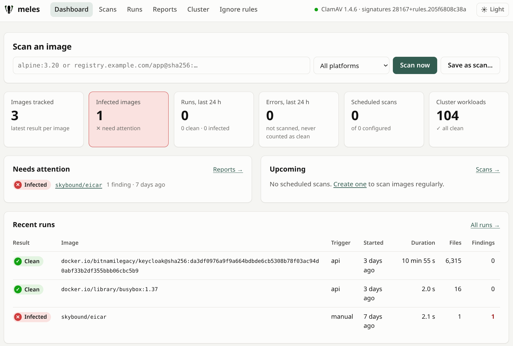

<p align="center">
  
</p>

# meles

**meles** is a malware scanner for container images. In Kubernetes it scans
every image your pods run and, if you want, holds new pods until their image
is scanned. It complements vulnerability scanners and runtime detection such
as Falco; it replaces neither.

- **Every layer is scanned separately.** A file that a later layer deletes
  (whiteout) still ships with the image and is still found, with the layer
  that added it and the one that deleted it.
- **Findings are traceable:** signature, file, layer digest, Dockerfile
  instruction, platform, and the author of the YARA rule.
- **Never falsely clean:** a file that could not be scanned makes the result
  `Incomplete`, never `Clean`.
- **Two engines in one clamd:** ClamAV's signatures and about 140 curated
  YARA rules for cryptominers, Linux malware, webshells and attacks on
  containers.
- **No Docker socket:** images are pulled straight from the registry.

By default meles only reports and never deletes anything.



## What the chart installs

| Component | Purpose |
|---|---|
| `<release>-mirror` | cvdupdate + `meles mirror` (HTTP). The only component that downloads signatures from Cisco Talos (at most hourly); also serves the YARA rules. |
| `<release>-clamd` | clamd workers; get signatures from the mirror. A token-checking TLS proxy sits in front of clamd. |
| `<release>-server` | web UI, cron schedules, run history (SQLite on a PVC). |
| `<release>-operator` | scans the image of every pod and writes a `MalwareReport` next to the workload; optional scan gate. Off by default. |
| `<release>-selftest` | CronJob that checks the whole chain daily with EICAR test images. |

NetworkPolicies restrict clamd to the pods of the release and the mirror to
clamd. Every component can be turned off.

## Install

Requirements: cluster admin for the CRDs, a default StorageClass, about 2 GB
of free memory on a node (clamd keeps the signatures in memory).

```sh
kubectl create namespace meles
kubectl label namespace meles pod-security.kubernetes.io/enforce=baseline
helm install meles oci://ghcr.io/movray/charts/meles -n meles --set operator.enabled=true
kubectl -n meles rollout status deploy/meles-clamd --timeout=15m
kubectl get malwarereports -A                            # every image running in your cluster
kubectl -n meles port-forward svc/meles-server 8080:80   # http://localhost:8080/
```

The clamd image starts as root and drops privileges itself, so the namespace
needs the `baseline` Pod Security level.

The operator pulls and scans the image of every pod, which counts against the
pull limits of your registries. For permanent use, expose the UI with
`server.httpRoute` or `server.ingress` and put a login in front of it with
`server.oauth2Proxy`: meles has no login of its own.

## Verify the chart

The chart and the image are signed with cosign (keyless) and carry build
provenance from GitHub Actions:

```sh
gh attestation verify oci://ghcr.io/movray/charts/meles:<version> -R movray/meles
```

## Configuration

The most important values; all of them are documented in `values.yaml` and in
the [Kubernetes section of the README](https://github.com/movray/meles#kubernetes).

| Value | Default | |
|---|---|---|
| `operator.enabled` | `false` | scan the image of every pod, write MalwareReports |
| `operator.gate.enabled` | `false` | scan gate: hold new pods in labelled namespaces until their images are scanned |
| `operator.prometheusRule.enabled` | `false` | alerts as a PrometheusRule |
| `operator.grafanaDashboard.enabled` | `false` | Grafana dashboard as a ConfigMap |
| `server.oauth2Proxy.*` | off | login for the web UI (e.g. with Keycloak) |
| `server.httpRoute.*`, `server.ingress.*` | off | expose the UI (Gateway API or Ingress) |
| `server.clusterReports.ignore` | `false` | create ignore rules from the web UI |
| `scan.maxFileSize` | `768M` | larger files are skipped and make the result `Incomplete` |
| `scan.registryMirrors` | `[]` | pull through a mirror first, e.g. a Harbor proxy cache |
| `yara.defaultRules` | `true` | the chart's YARA rules |
| `yara.extra` | `[]` | own YARA rules from ConfigMaps |
| `clamd.auth.enabled` | `true` | TLS + token in front of clamd |
| `networkPolicy.enabled` | `true` | NetworkPolicies for clamd and the mirror |
| `harborAdapter.enabled` | `false` | pluggable scanner for Harbor, optionally chained with Trivy |

## Documentation

- [Getting started](https://github.com/movray/meles/blob/main/docs/getting-started.md):
  a step-by-step tour, from a first scan to the scan gate
- [Reading the results](https://github.com/movray/meles/blob/main/docs/results.md):
  what Clean, Infected, Incomplete and Error mean
- [Architecture and security model](https://github.com/movray/meles/blob/main/docs/architecture.md)
- [README](https://github.com/movray/meles#readme): CLI, CI, web UI, operator,
  scan gate, Harbor

## License

Apache-2.0. The ClamAV signatures are downloaded at runtime from Cisco Talos
and subject to their terms. The YARA rules keep the licenses of their
sources, listed in
[charts/meles/rules](https://github.com/movray/meles/tree/main/charts/meles/rules#readme).
